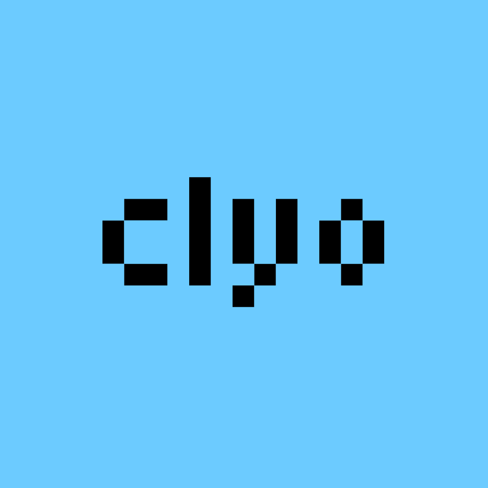

<div align="center">
  
  <h1>ClyoCloud Desktop Client</h1>
  <p>Windows and Linux desktop app for <a href="https://code.weexnes.dev/ClyoCloud">ClyoCloud</a>: the full web app in a native window, plus tray sync, uploads and wallpapers.</p>
  <p>
    <a href="#install"></a>
    <a href="#build-from-source"></a>
  </p>
</div>

---

A lightweight companion application for ClyoCloud with feature and visual parity with the native macOS client, for
**Windows 10/11** and **Linux** desktops. It lives in your system tray with a frosted-glass popover, real-time two-way
folder synchronization, drag-and-drop cloud uploads, one-click cloud wallpaper management, an instant clipboard uploader
with a global hotkey, and standalone setup wizards built with **InstallerFramework**.

## Features

- **Full ClyoCloud app window** (new in 1.1.0):
  - The complete ClyoCloud web interface in a native, resizable window: every page and feature of the website (files, media, theatre, wallpapers, ComfyUI wallpaper generation, settings, admin…), pixel-identical, because it is the server's own UI. It updates whenever the server does.
  - Signs in automatically with the companion's account; signing in or out in the window signs the companion in or out too.
  - Native downloads into your Downloads folder with taskbar progress and a notification ("click to show in folder"); files are never overwritten.
  - Remembers its size, position and maximized state; opens on launch (not on autostart, which starts in the tray), and launching ClyoCloud again brings it to the front.
  - Links to other sites open in your browser; `Ctrl+R`/`F5` reload, `Alt+←/→` and mouse buttons for back/forward, `Ctrl+=`/`Ctrl+-`/`Ctrl+0` zoom, `F11` full screen, spell-check and a right-click menu.
  - A setup / offline page (same black design) when the server can't be reached, with retry and a server address field.
  - Open it from the tray menu (**Open ClyoCloud**) or the popover; **Open in Browser** is still there.
- **Native system tray integration:**
  - Clean monochrome tray icon (cloud when idle, rotating blue sync icon during transfers).
  - Left-click opens the frosted-glass popover anchored to the tray; right-click opens a quick utility context menu (`Open Web`, `Sync All Now`, `Upload Clipboard`, `Preferences`, `Quit`).
  - Auto-hide on blur (clicking outside the window), matching macOS NSPopover behavior. This is disabled on tiling environments like HyDE/Hyprland, so the window stays open alongside other desktop windows.
- **Drag-and-drop upload zone:**
  - Glassmorphic drop target that accepts multiple files or folders from Windows File Explorer or Linux file managers.
  - Destination folder picker (upload to the cloud root `/` or any remote folder).
  - Real-time transfer progress tracking and recent activity history.
- **Cloud desktop wallpaper gallery:**
  - Scrollable 2-column grid of cloud wallpapers from `/api/wallpapers`.
  - Authenticated thumbnail caching via `/thumbnail/{path}` with fallback to `/file/{path}`.
  - One-click **"Set as Desktop"** with native OS integration:
    - **Windows:** sets the wallpaper via `user32.dll` `SystemParametersInfoW`.
    - **Linux:** automatic detection and native configuration for GNOME, KDE Plasma, XFCE, MATE, Cinnamon, and X11 tools (`feh`, `nitrogen`).
  - Visual feedback ("Applied!" with a checkmark).
  - **HyDE (Hyprland) support:** when `~/.config/hyde/themes` exists, the button becomes **"Add Wallpaper to Theme"** and only downloads the image into the active theme's `wallpapers/` folder (theme read from `~/.local/state/hyde/staterc`). It never changes the current wallpaper; pick it yourself with HyDE's wallpaper selector.
- **Real-time two-way folder synchronization:**
  - Cross-platform filesystem monitoring via **chokidar** (`ReadDirectoryChangesW` on Windows, `inotify` on Linux) with no CPU overhead.
  - Two-way differential reconciliation engine comparing remote files (`/api/files`) against local directories.
  - **Phase 1, local rename detection:** detects local renames and moves and runs server-side renames (`/api/rename`) without re-uploading large data.
  - **Phase 2, 3-way reconciliation:** handles additions, modifications, remote downloads, local uploads, and conflicts (keeping local copies as `(Conflict <timestamp>)`).
  - Automatic exclusion of metadata and temp files (`.DS_Store`, `Thumbs.db`, `desktop.ini`, `.cloudinfo`, `.tmp`, `.crdownload`).
- **Screenshot and clipboard uploader:**
  - Click **"Upload Clipboard"** or press **`Ctrl + Alt + U`** (or `Cmd + Alt + U`) anywhere on your system to grab the image from your clipboard, upload it to ClyoCloud, copy the shareable file URL back to your clipboard, and show a desktop notification.
- **Dual authentication:**
  - **Quick device token / QR payload:** paste a device token or QR JSON payload from ClyoCloud settings. Reports the device model (e.g. `Windows 11 (build 22631, x64)` or `Linux (Ubuntu 24.04, x64)`) to the server.
  - **Standard credentials:** username and password, with support for TOTP 2FA codes and recovery scratch keys.
  - Tokens are stored via Electron `safeStorage` (Windows DPAPI / Linux Secret Service), with a restricted-permissions fallback.
- **Setup wizards (InstallerFramework):**
  - Single-file, standalone setup wizards for Windows (`ClyoCloud-Setup-Windows.exe`) and Linux (`ClyoCloud-Setup-Linux`), built with [InstallerFramework](https://code.weexnes.dev/InstallerFramework.git) (Avalonia UI).
  - Welcome page, license agreement, destination directory selection, shortcut creation, live extraction progress bar, and launch on completion.
- **Launch at system login:**
  - **Windows:** registry `HKCU\Software\Microsoft\Windows\CurrentVersion\Run` and Electron login item settings.
  - **Linux:** XDG autostart `~/.config/autostart/clyocloud.desktop`.

## Requirements

- Node.js 18+ (tested on Node 24)
- npm 9+
- .NET SDK 8.0+ (for building the setup wizards)

## Install

Use the setup wizard for your platform (`ClyoCloud-Setup-Windows.exe` or `ClyoCloud-Setup-Linux`), published as build
artifacts by the OneDev pipeline.

### Direct system installation (clone and install)

You can install ClyoCloud directly into your desktop environment, with application launcher shortcuts, desktop icons
and terminal command integration, the same as running the setup wizard:

```bash
git clone https://code.weexnes.dev/ClyoCloud/DesktopClient.git
cd DesktopClient
npm install
# or 'make install'
npm run install
```

To remove the installation:

```bash
# or 'make uninstall'
npm run uninstall
```

## Build from source

```bash
cd DesktopClient

# Install dependencies (if not already installed)
npm install

# Compile TypeScript and bundle assets
npm run build

# Launch the desktop client
npm start
```

### Packaging binaries and installers

All platforms at once:

```bash
# Set up the installer framework environment
make installer-setup

# Build both Linux and Windows single-file installers
make installer-all
```

Output files are generated in `installer/publish/`:

- Windows: `installer/publish/win-x64/ClyoCloud-Setup-Windows.exe`
- Linux: `installer/publish/linux-x64/ClyoCloud-Setup-Linux`

Individual platform builds:

| Command | Builds |
| :-- | :-- |
| `make installer-linux` | Linux installer only |
| `make installer-win` | Windows installer only |
| `make package-linux` / `make package-win` | Direct Electron packages |

### OneDev CI/CD pipeline

The repository includes a ready-to-run [`.onedev-buildspec.yml`](.onedev-buildspec.yml) configured with the `Builder`
job executor. It:

1. Checks out the code repository
2. Runs `npm install` and `npm run build`
3. Packages unpacked application payloads for Linux and Windows (`electron-builder --dir`)
4. Clones and configures `InstallerFramework`
5. Compiles the standalone single-file setup wizards (`ClyoCloud-Setup-Windows.exe` and `ClyoCloud-Setup-Linux`)
6. Extracts the current version from `package.json` into `version.txt`
7. Publishes all installer binaries as build artifacts in OneDev

## Project structure

```text
DesktopClient/
├── .onedev-buildspec.yml      # Automated OneDev CI/CD pipeline
├── package.json               # Dependencies, build scripts, electron-builder config
├── tsconfig.json              # TypeScript configuration
├── Makefile                   # Quick build, run, package, and installer targets
├── scripts/
│   └── build.js               # Esbuild compilation & asset pipeline
├── assets/                    # App & tray icons
│   ├── icon.png               # ClyoCloud application icon (1024x1024)
│   ├── icon.ico               # Windows application icon
│   ├── tray-idle.png          # Monochrome tray icon (cloud)
│   └── tray-syncing.png       # Animated/active tray icon (sync)
├── installer/                 # Standalone InstallerFramework project
│   ├── ClyoCloudInstaller.csproj # .NET 8 installer project definition
│   ├── Program.cs             # Fluent installer wizard definition (Avalonia UI)
│   ├── setup.sh / setup.ps1   # InstallerFramework clone & restore script
│   └── build.sh / build.ps1   # Single-file installer publish script
└── src/
    ├── shared/
    │   └── types.ts           # Shared data models (ClyoFile, ServerStats, SyncFolderPair)
    ├── main/
    │   ├── index.ts           # App lifecycle, single-instance lock, IPC handlers
    │   ├── tray.ts            # Tray creation, context menu, popover positioning & toggling
    │   ├── api/
    │   │   └── clyoApi.ts     # REST API client (login, 2FA, files, stats, upload, download)
    │   ├── sync/
    │   │   ├── syncEngine.ts  # 2-way differential sync engine (rename detection, 3-way reconciliation)
    │   │   ├── watcher.ts     # chokidar filesystem watcher with debounce
    │   │   └── manifest.ts    # Per-pair state manifest manager
    │   ├── platform/
    │   │   ├── wallpaper.ts   # Windows (user32.dll) & Linux (GNOME/KDE/XFCE/feh) wallpaper setter
    │   │   ├── hyde.ts        # HyDE detection: download wallpapers into the active theme folder
    │   │   ├── autostart.ts   # Windows Registry & Linux XDG autostart manager
    │   │   └── device.ts      # OS release & device model detection
    │   ├── clipboard/
    │   │   └── uploader.ts    # Clipboard image grab, upload, share link copy, notification
    │   └── storage/
    │       ├── settings.ts    # Settings persistence (settings.json)
    │       └── secureStore.ts # Safe storage (DPAPI/libsecret with fallback)
    ├── preload/
    │   └── preload.ts         # Secure typed contextBridge API
    └── renderer/
        ├── index.html         # Popover UI layout
        ├── styles/
        │   ├── main.css       # Frosted glass design system, typography, animations
        │   └── components.css # Tabs, dropzone, cards, modal, switches
        └── src/
            └── app.ts         # Reactive state manager, tabs controller, UI logic
```

## License

No license has been chosen yet.
